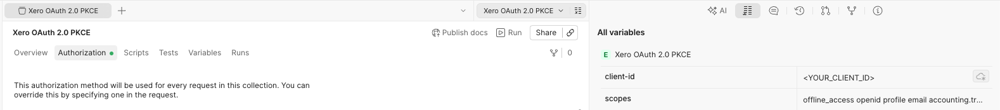
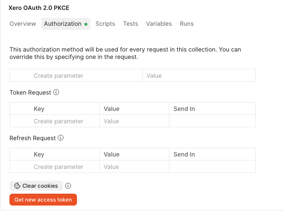
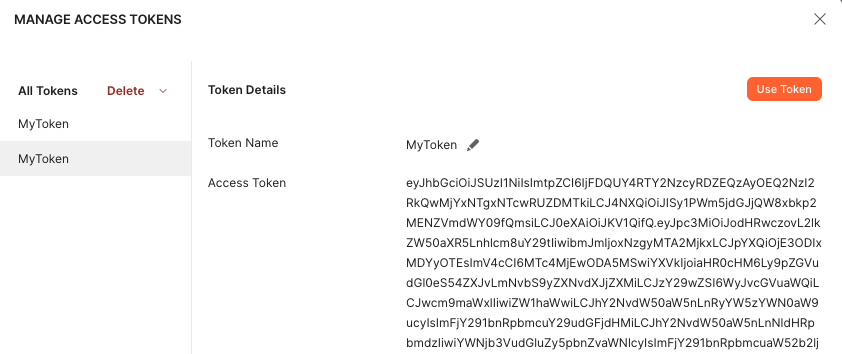
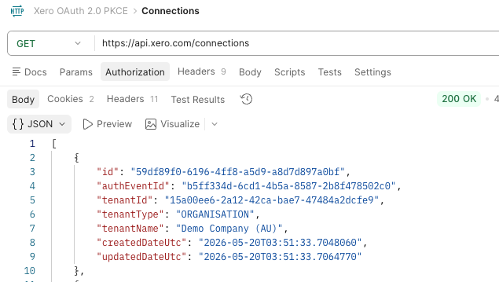

# Xero PKCE OAuth 2.0 with Postman

A Postman collection for authenticating to the Xero API using a PKCE (Proof Key for Code Exchange) app.

## Prerequisites

- Postman desktop app installed (browser extension does not support environment variables)
- A PKCE app created at [developer.xero.com](https://developer.xero.com/app/manage) with your `client_id` ready
- Add `https://oauth.pstmn.io/v1/callback` as one of your app's redirect URIs

---

## Phase 1: Setup

### 1. Import the collection and environment

Download `XeroOAuth2PKCE.postman_collection.json` and `XeroOAuth2PKCE.postman_environment.json` from this repo and import them via **File → Import** in Postman.

### 2. Configure your environment variables

1. Select the **Xero OAuth 2.0 PKCE** environment from the environment dropdown (top right of Postman)
2. Click the eye icon → **Edit**
3. Fill in the following variables:

| Variable | Value |
|---|---|
| `client_id` | Your app's client ID from developer.xero.com |
| `scopes` | Space-separated list of scopes (see below) |

**Recommended scopes to start:**
```
openid profile email offline_access accounting.transactions accounting.contacts accounting.settings
```

> `offline_access` is required to receive a refresh token.



---

## Phase 2: Get a Token

### 3. Get an access token

1. Select the **Authorization** tab
2. Click **Get New Access Token**



3. Log in to Xero in the browser window that opens
4. Select the organisation to connect and grant access
5. The authorisation process completes and redirects back to Postman for you to get the token 



#### Sanity check

You should be able to use the access token to call the Connections endpoint and retrieve your connected tenants.



### 4. Use the token to connect to your MCP Host of choice

You can now use the token to connect to Xero's MCP Server

**Note**: The token expires after 30 minutes so you will have to re-retrieve the token or refresh the current token.

